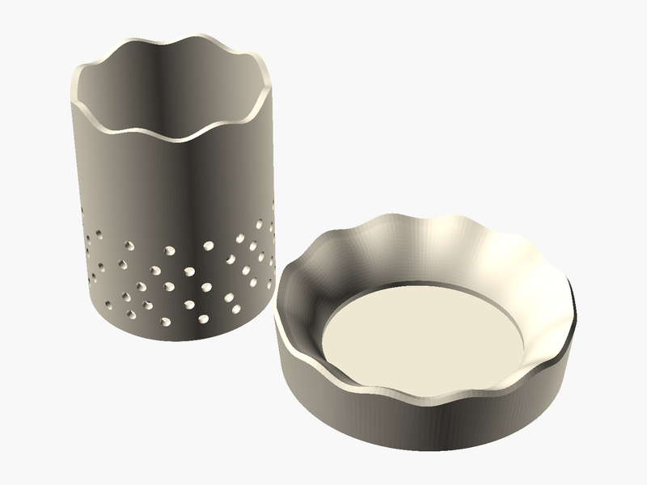

# Plant-a-Cup

**Created by:** Oscar

It is the better way to grow plants because the cup is biodegradable so you can grow it in your house then plant it outside. It’s useful because it’s harder to grow a plant outside and it’s hard to keep a plant alive inside. 

The holes are for the roots to reach the water you put the cup by a window for more sunlight.

## Printed with PHA 🌱

**What is PHA?** PHA is a plastic made by tiny microbes! They munch on plant sugars and oils and store the PHA inside their bodies, kind of like how we store energy.

**Why is it eco-friendly?** It comes from plants instead of oil. And when it's all done, it can break down back into nature (in soil, and even in the ocean) instead of hanging around for hundreds of years.

**Printing tips:**
- 🧊 **Keep it cool:** set the nozzle to about 190–200 °C.
- 💨 **Lots of air:** turn the cooling fan up high and leave the printer doors or lid open.
- 🐢 **Go a little slower:** slower prints help each layer stick and cool nicely.
- ☀️ **Keep it dry:** store the spool in a bag with a desiccant pack so it doesn't soak up water.
